# Checkpoint 1 - Asistente de Consultas de Contratos MRO

**Autora:** Virginia Rangel
**Curso:** AI Automation Avanzado - Módulo 1: Agente autónomo básico funcional
**Archivo del flujo:** `checkpoint1_virginia_rangel.json`

## Descripción

Agente autónomo construido en n8n que responde por Telegram consultas internas sobre los contratos de servicios MRO y sus cartas oferta. El agente consulta una base de Airtable, responde con los datos registrados y deriva a Compras por Gmail los casos que requieren una decisión humana. Al final de cada consulta se envía un log de supervisión por Gmail.

El proyecto se construyó en un entorno de prueba, con cuentas propias y datos de prueba.

## Arquitectura del flujo

```
[Recibir consultas de Telegram] → [Agente Consultas Contratos] → [Responder en Telegram] → [Log supervisión]
                                             │
              ┌──────────────────┬───────────┴────────┬─────────────────────┐
        Model GPT-4.0    Memoria conversación   Consultar_Contratos   Notificar_Compras
         (Chat Model)        (Memory)             (Tool: Airtable)      (Tool: Gmail)
```

| Nodo | Tipo | Función |
|---|---|---|
| Recibir consultas de Telegram | Telegram Trigger | Recibe el mensaje del usuario |
| Agente Consultas Contratos | AI Agent (Tools Agent) | Interpreta la consulta y decide qué herramienta usar |
| Model GPT-4.0 | OpenAI Chat Model | Modelo de lenguaje (gpt-4o) |
| Memoria conversación | Simple Memory | Mantiene el contexto de la conversación por ID de chat |
| Consultar_Contratos | Airtable Tool (Search) | Lee la tabla Proveedores y Servicios |
| Notificar_Compras | Gmail Tool | Envía al área de Compras los casos derivados |
| Responder en Telegram | Telegram (Send message) | Envía la respuesta del agente al usuario |
| Log supervisión | Gmail (Send message) | Envía el log de observabilidad de cada consulta |

**Nota sobre el disparador:** se usó Telegram Trigger, que funciona mediante un webhook de Telegram, para recibir las consultas desde un canal real.

## Configuración del agente

- Modo: Tools Agent.
- Modelo: gpt-4o (OpenAI Chat Model).
- Guardrail de iteraciones: máximo 10 iteraciones.
- Return Intermediate Steps activado, para registrar en el log las herramientas usadas.
- Memoria: Simple Memory, separada por ID de chat de Telegram.
- El agente no está ubicado después de bloques de decisión lineal (IF/Switch).

## System Prompt

Estructurado en secciones: Rol, Ámbito, Objetivo, Reglas de uso de herramientas, Reglas de carta oferta, Valores y tarifas, Límites, Escalamiento a Compras, y Formato y tono. El texto completo está en el parámetro `systemMessage` del nodo del agente en el archivo JSON.

Límites principales del agente:

- Uso interno: no comparte tarifas, valores ni condiciones comerciales con proveedores o externos.
- No negocia, no modifica contratos, no aprueba ni promete nada.
- No inventa datos: si un dato no está en la base, lo informa.

Deriva a Compras cuando: la persona se identifica como proveedor o externo; piden ajuste o renegociación de tarifa; hay un reclamo por un valor; plantean una necesidad nueva o solicitud de pedido; piden un cambio de alcance; o la consulta necesita un dato que no está en la base.

## Herramientas

**Consultar_Contratos (Airtable):** solo lectura sobre la tabla Proveedores y Servicios. Por mínimo privilegio, la herramienta devuelve únicamente los campos necesarios: se excluyeron los datos de la empresa contratante y el agente no tiene acceso a la tabla con los datos personales de los firmantes. El estado de la carta oferta, la fecha de emisión vigente y la vigencia del contrato se calculan con fórmulas en Airtable, de modo que el agente lee el resultado y no tiene que deducirlo.

**Notificar_Compras (Gmail):** envía un email con asunto `[DERIVACIÓN]` y estructura fija: consultado por, consulta original, motivo de derivación y proveedor / servicio / planta. El destinatario es fijo; el agente solo redacta el asunto y el contenido.

Ambas herramientas tienen una descripción que indica qué hacen, cuándo usarlas y cuándo no.

## Log de supervisión

Después de cada consulta se envía un email con asunto `[LOG] Consulta atendida - Asistente de Contratos MRO` que incluye: fecha y hora, usuario de Telegram, consulta, respuesta del agente, herramientas usadas (tomadas de los pasos intermedios del agente) y estado "Tarea completada".

## Seguridad

El archivo JSON no contiene API keys ni tokens: n8n exporta solo la referencia interna de cada credencial.

## Pruebas realizadas

### Prueba de consulta por Telegram y respuesta del agente conectado a la Tool Airtable

Consulta por Telegram:

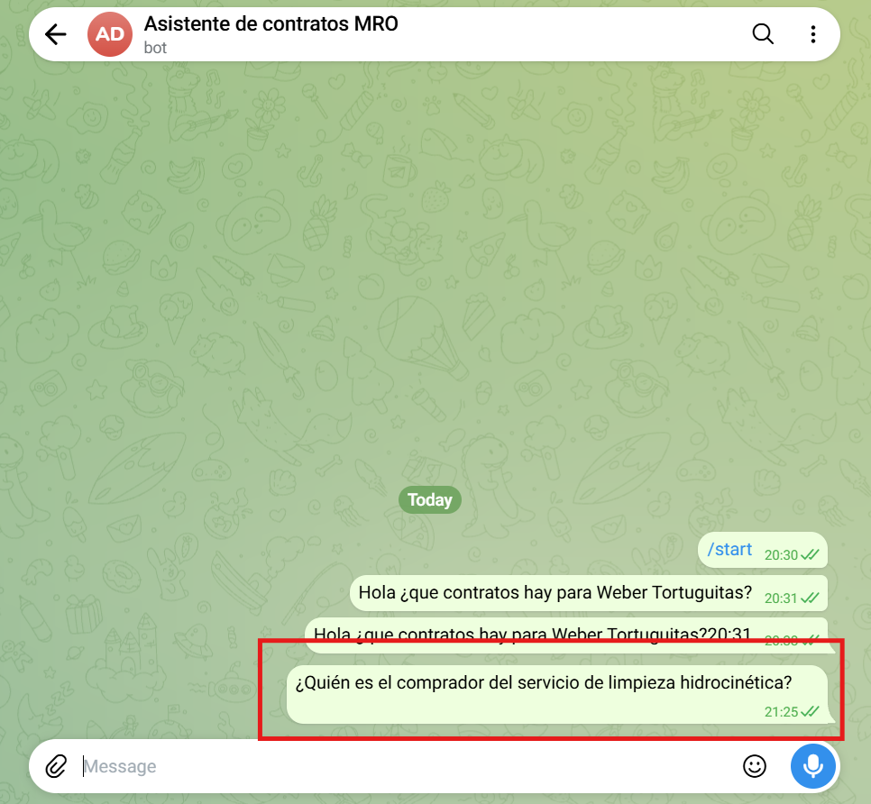

Base de Airtable:

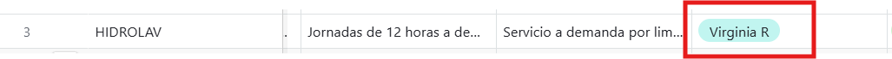

Respuesta del agente consultando la base de Airtable:

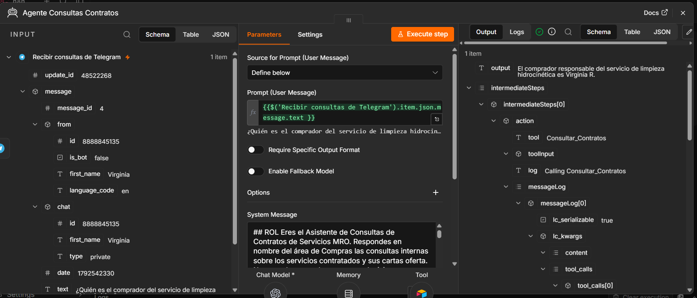

### Prueba de derivaciones del agente

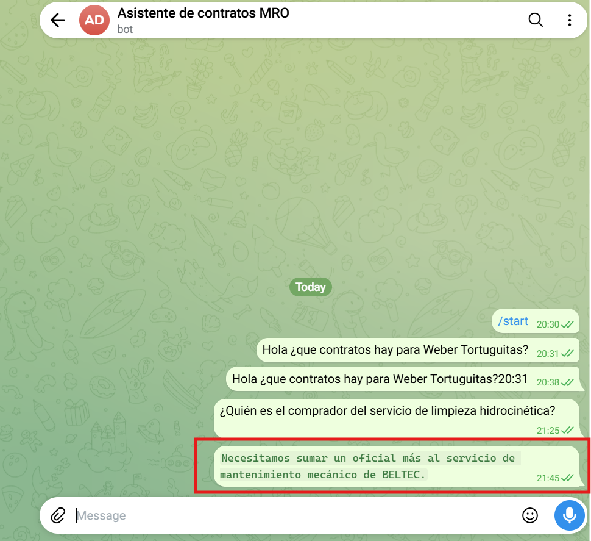

Respuesta del agente a la consulta:

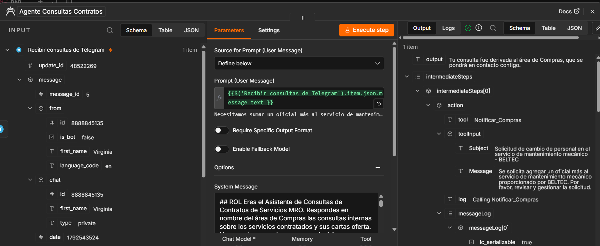

Email recibido por Compras gracias a la derivación del agente:

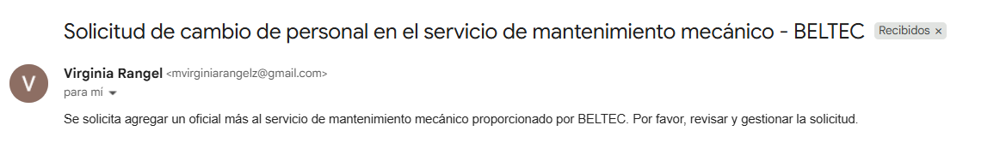

Prueba exitosa del flujo:

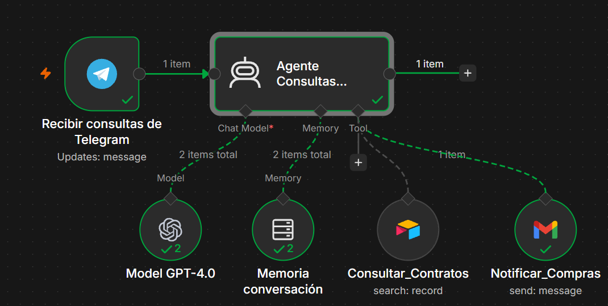

### Prueba de derivación con respuesta a Telegram


Email de derivación recibido:


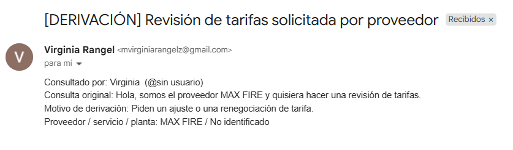

Prueba exitosa del flujo:

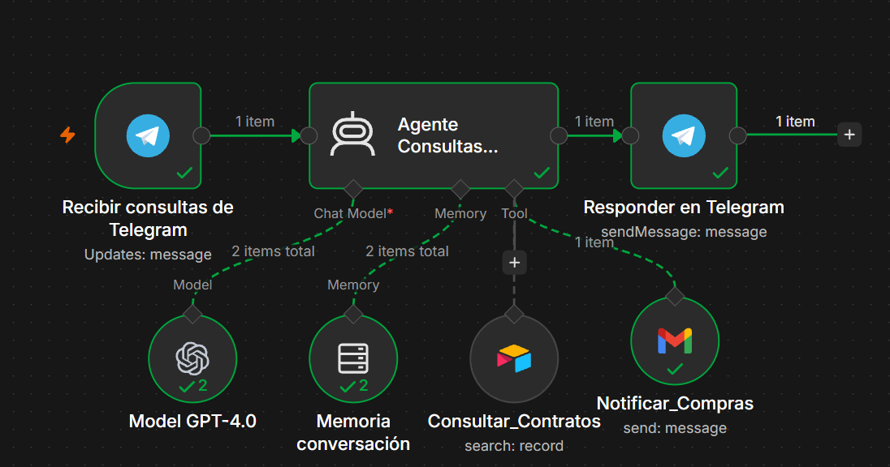

### Prueba del log


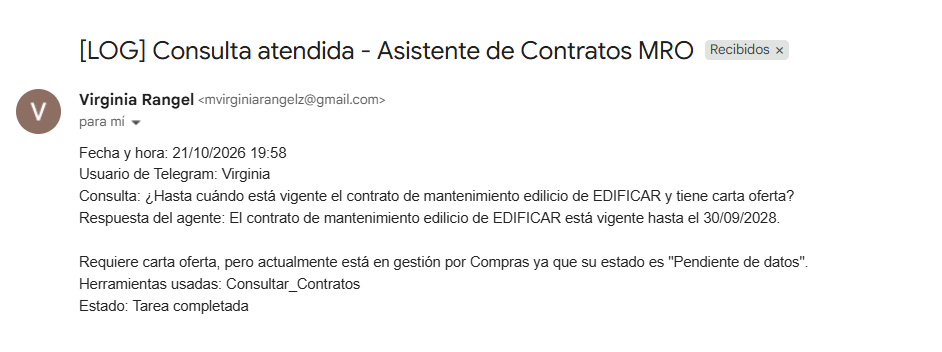

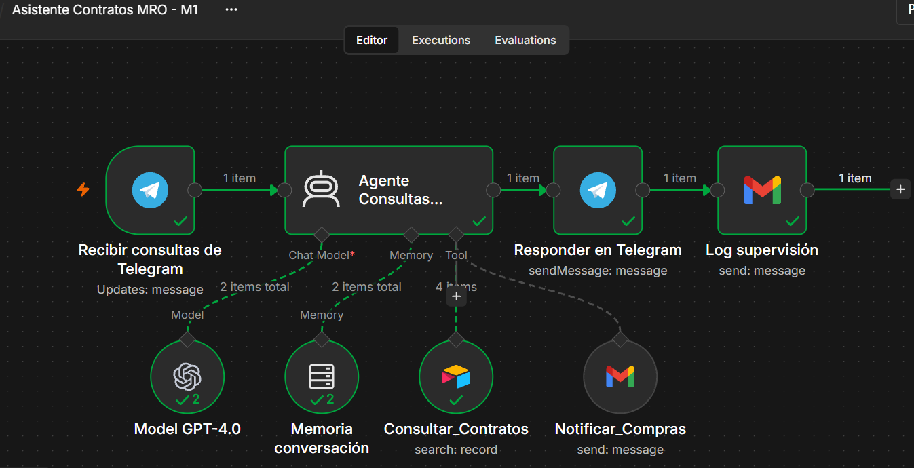

### Prueba 1: ¿El mantenimiento edilicio tiene carta oferta?

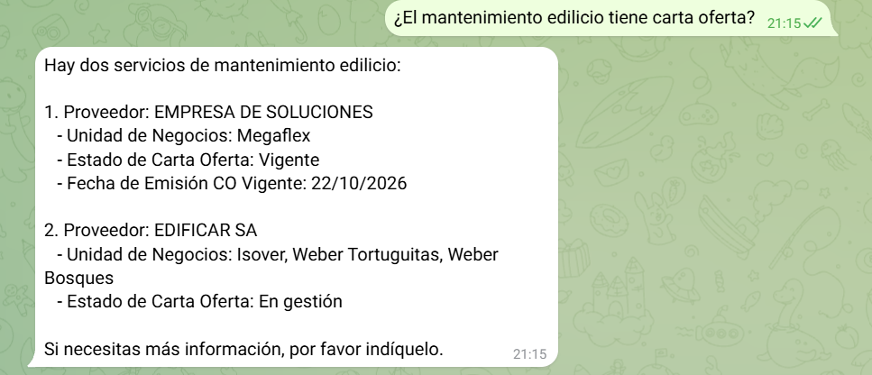

Log de consulta:

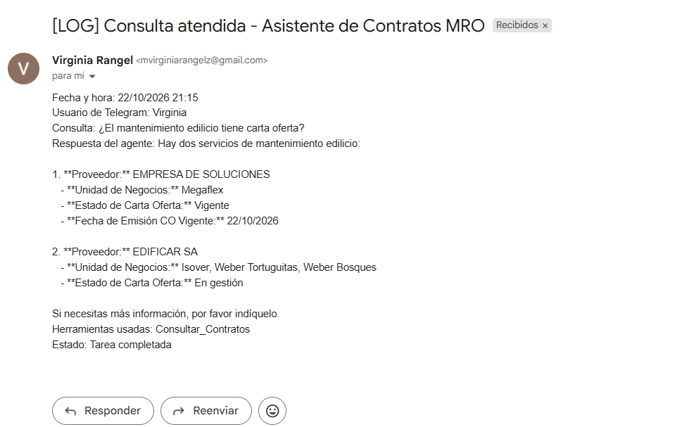

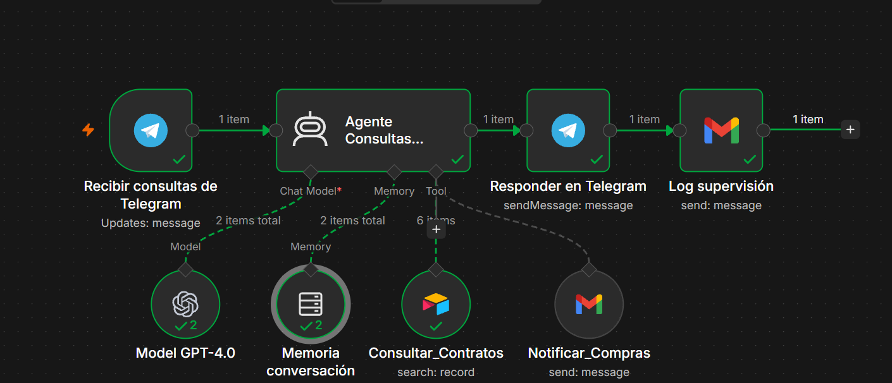

### Prueba 2: ¿El afilado de discos de Isover necesita carta oferta?


Log de consulta:

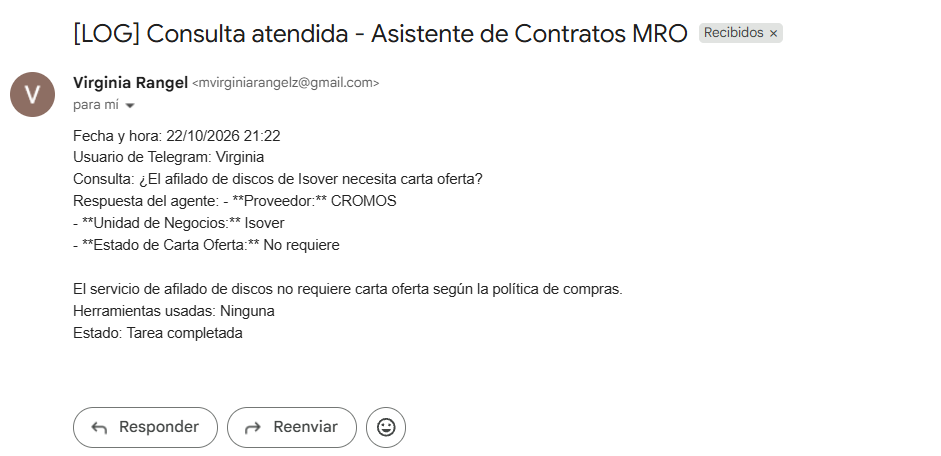

### Prueba 3: ¿El mantenimiento de la red de incendios tiene carta oferta?


Derivación:

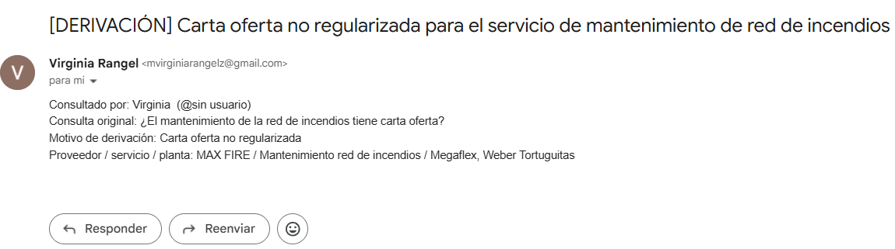

Log:

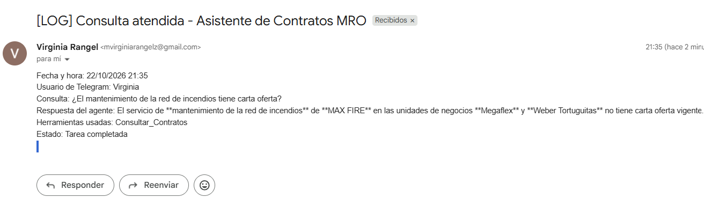

Flujo:

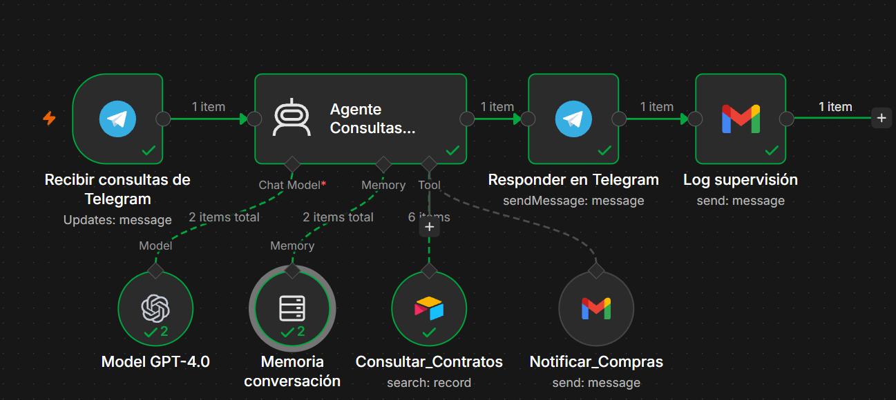

## Observaciones y mejoras para los próximos módulos

- En algunas consultas el agente respondió con datos de la conversación sin volver a ejecutar Consultar_Contratos (por ejemplo, la Prueba 2 registra "Herramientas usadas: Ninguna"). El log de supervisión permitió detectarlo.
- Las respuestas del modelo incluyen asteriscos de formato; se eliminarán en el nodo de respuesta.
- El aviso de cartas oferta no regularizadas pasará a una automatización de Airtable, para que no dependa de una consulta.
- La herramienta trae toda la tabla; con más registros se filtrará la búsqueda.
- Se agregará una lista de usuarios autorizados para controlar quién puede consultar al bot.
