# Pre-entrega 4: Integraciones avanzadas e interconexión de sistemas

**Proyecto:** Asistente de Consultas de Cartas Oferta MRO
**Autora:** Virginia Rangel
**Curso:** AI Automation Avanzado - Módulo 4
**Archivo:** `checkpoint4_virginia_rangel.json` (workflow *Asistente CO MRO - M4 Manager*)

## Descripción

Sobre el Manager del Módulo 3 (Telegram, clasificador, Workers y memoria en Airtable) se agregó una segunda entrada por email. Una persona de planta escribe a la casilla de consultas, el sistema registra el contacto en Airtable, el Worker 1 redacta la respuesta con los datos de la base y la respuesta queda como **borrador** en Gmail para que Compras la revise antes de enviarla. Al mismo tiempo se avisa al equipo por Slack.

## Herramientas conectadas (OAuth2)

| Rol | Herramienta | Uso en el flujo | Lectura / escritura |
|---|---|---|---|
| CRM (datos de contactos) | Airtable, tabla **Contactos** | Registrar quién consulta por email | Lee el contacto por email; crea o actualiza su fila |
| Casilla de correo | Gmail (casilla de consultas) | Recibir consultas y guardar la respuesta | Lee emails no leídos de INBOX; solo crea borradores |
| Canal del equipo | Slack, canal **#asistente-consultas-email** | Avisar que entró una consulta | Solo publica mensajes en ese canal |

### Credentials en n8n

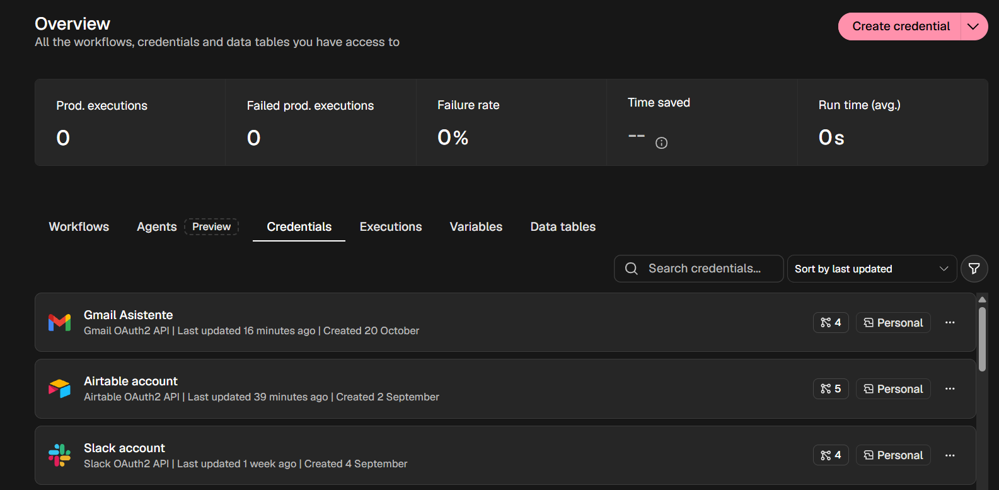

## Flujo del email

```
[Gmail Trigger: Recibir email de consulta]
        ▼
① [IF ¿Es respuesta automática?] ── true ─▶ [Ignorar email automático]
        │ false
        ▼
④ [Set: Limpiar datos del email] → [IF ¿Email válido?] ── false ─▶ [Descartar email sin datos]
        │ true
        ▼
② [Airtable: Buscar contacto] → [IF ¿Contacto existe?]
        ├─ true  → [Actualizar contacto]
        └─ false → [Crear contacto]
        ▼
   [Llamar al Worker 1] → [Set: Armar borrador]
        ▼
③ [Gmail: Crear borrador en Gmail]
        ▼
④ [Set: Preparar aviso Slack] → [Slack: Aviso de consulta por email]
```

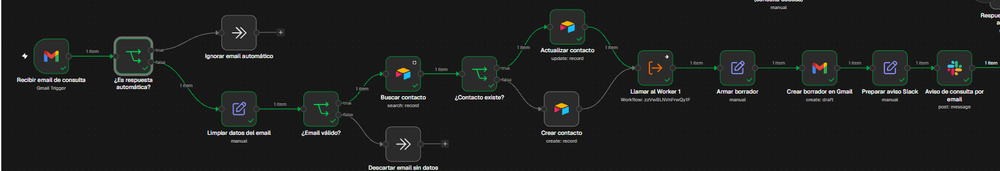

### Workflow Manager completo (Telegram + email)

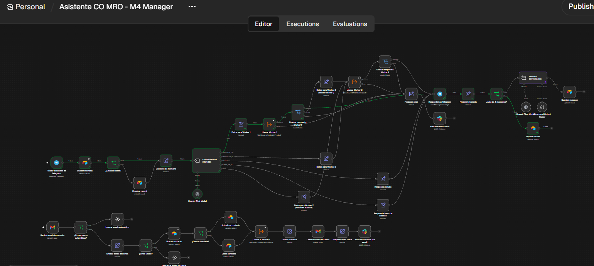

## Controles preventivos

**① IF anti respuesta automática (bucle infinito).** Inmediatamente después del trigger. Condiciones en OR, sin distinguir mayúsculas:
- Asunto contiene: *auto-reply*, *automatic reply*, *respuesta automática*, *out of office*, *fuera de la oficina* o *undeliverable*.
- Remitente contiene: *no-reply*, *noreply* o *mailer-daemon*.
- Remitente igual a la propia casilla de consultas. El Worker 2 envía las derivaciones a Compras desde y hacia esa casilla; sin esta condición, el sistema intentaría responder sus propios emails.

**② Buscar antes de crear (error 409, duplicados).** *Buscar contacto* filtra la tabla Contactos con `{Email} = '{{ $json.email }}'` y tiene *Always Output Data* activado. El IF *¿Contacto existe?* decide entre actualizar la fila existente (suma una consulta, actualiza fecha y asunto) o crear una nueva. El email se guarda en minúsculas y sin espacios para que la búsqueda no falle por diferencias de formato.

**③ Create Draft (Human-in-the-loop).** El nodo de Gmail usa solo la operación *Draft → Create*. La respuesta queda en Borradores, dentro de la misma conversación del email original (Thread ID), y una persona de Compras decide si enviarla. El flujo no envía emails por su cuenta.

**④ Set de limpieza (payload pesado y error 400).**
- *Limpiar datos del email* deja solo email, nombre, asunto, texto (sin saltos repetidos, máximo 2000 caracteres), message_id y thread_id. Descarta encabezados, HTML y adjuntos.
- *¿Email válido?* verifica que el email contenga @ y que el texto no esté vacío antes de llegar a Airtable.
- *Preparar aviso Slack* arma un único texto con remitente, asunto, estado y los primeros 300 caracteres de la respuesta, para no enviar a Slack la respuesta completa del nodo de Gmail.

## Mínimo privilegio

- **Gmail:** el trigger lee solo INBOX y emails no leídos, sin descargar adjuntos. La única escritura es crear borradores.
- **Airtable:** la credencial OAuth2 tiene acceso solo a la base del proyecto. *Buscar contacto* devuelve solo los campos Email y Cantidad de consultas.
- **Slack:** publica solo en el canal del equipo, sin enlace al workflow.

## Tabla Contactos (Airtable)

| Campo | Tipo | Propósito |
|---|---|---|
| Email | Texto (campo principal) | Identifica al contacto; es el dato que se busca |
| Nombre | Texto | Nombre del remitente |
| Primer contacto | Fecha y hora | Primera consulta por email |
| Último contacto | Fecha y hora | Última consulta por email |
| Cantidad de consultas | Número | Consultas recibidas de ese contacto |
| Último asunto | Texto | Asunto del último email |

## Pruebas de regresión

| Prueba | Resultado |
|---|---|
| 1. Contacto nuevo | *¿Contacto existe?* sale por false y se crea la fila con 1 consulta |
| 2. Mismo contacto | Sale por true y se actualiza la misma fila (2 consultas), sin duplicados |
| 3. Borrador HITL | La respuesta del Worker 1 queda en Borradores de Gmail, dentro de la conversación |
| 4. Aviso en Slack | Llega el aviso con remitente, asunto, estado y respuesta |
| 5. Anti-bucle por remitente | Email enviado desde la propia casilla: sale por true y se ignora |
| 6. Anti-bucle por asunto | Asunto "Respuesta automática: fuera de la oficina": sale por true y se ignora |
| 7. Regresión Telegram | El camino de Telegram con memoria sigue respondiendo con el nombre del usuario |

**Prueba 1: contacto nuevo**

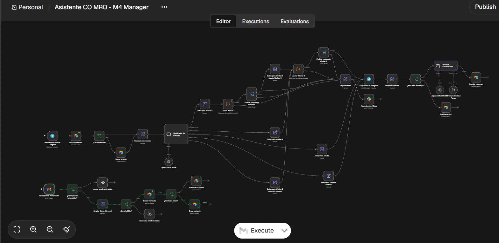
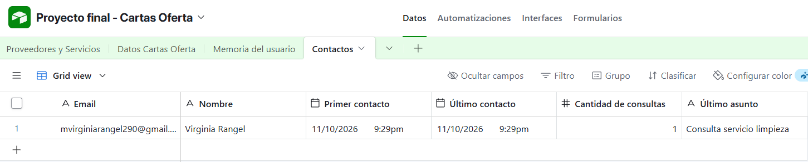

**Prueba 2: sin duplicados**

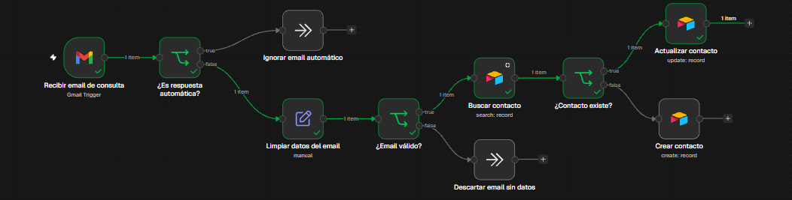
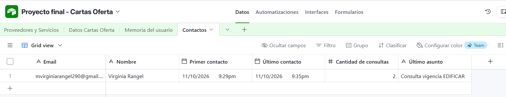

**Prueba 3: borrador para aprobación humana**

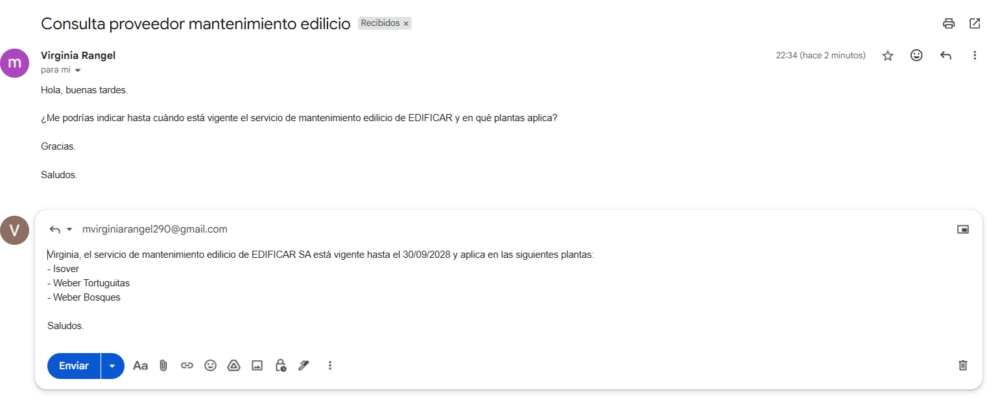

**Prueba 4: aviso en Slack**

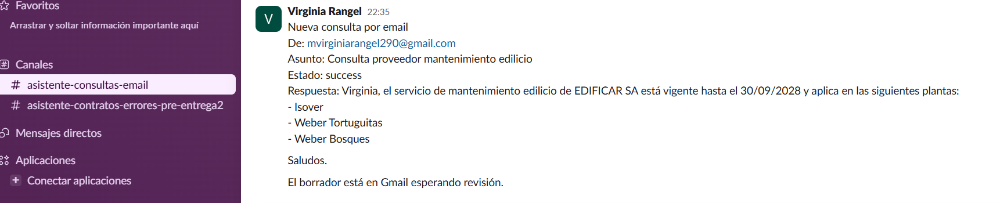
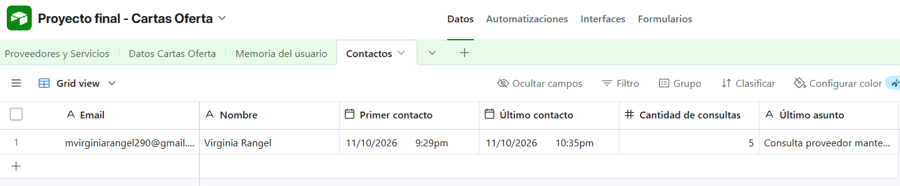

**Prueba 5: anti-bucle por remitente**

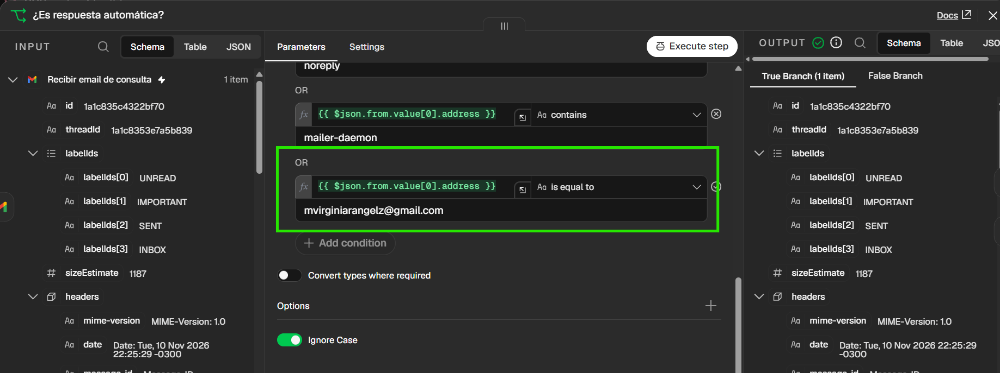

**Prueba 6: anti-bucle por asunto**

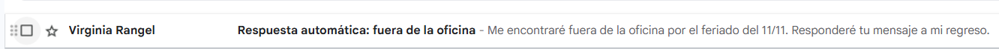
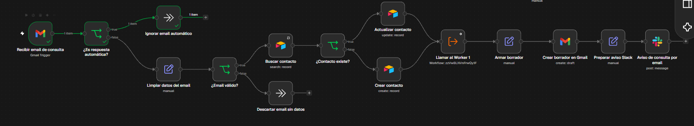

**Prueba 7: regresión por Telegram**


## Cómo importar

1. En n8n: **Workflows → Import from File** y elegir `checkpoint4_virginia_rangel.json`.
2. Asignar credenciales propias de Telegram, OpenAI, Airtable (OAuth2), Gmail (OAuth2) y Slack (OAuth2).
3. Los nodos *Llamar Worker 1*, *Llamar al Worker 1* y *Llamar Worker 2* llaman a los workflows Worker 1 y Worker 2 del proyecto; hay que seleccionarlos de nuevo en la instancia donde se importe.
4. En el IF *¿Es respuesta automática?*, reemplazar la dirección de la casilla propia por la de la casilla de consultas que se use.
